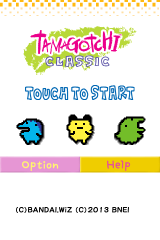
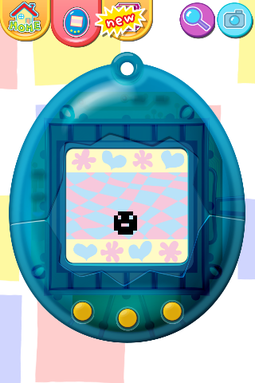
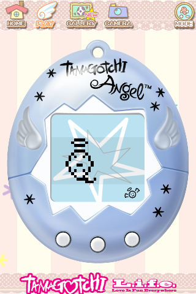
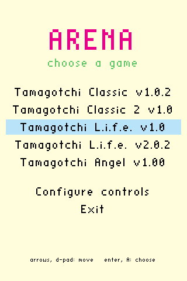
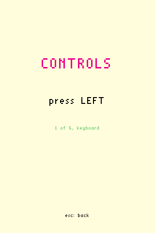

# Arena: tamatama

[English](README.md) | Español

**Jugable.** El juego funciona de principio a fin con el ratón como touch, o
con teclado o mando (ver [Ejecutar](#ejecutar)): esa parte está terminada. La
migración a código nativo sigue en una fase temprana y avanzará con calma, en
mis ratos libres, como un proyecto para aprender y experimentar.

Tamagotchi Classic (Android) migrado poco a poco a código nativo con Arena.
Versiones compatibles (`src/port/apk_table.h`): Tamagotchi Classic 1.0.2,
Tamagotchi Classic 2 (Gen-2) 1.0, Tamagotchi L.i.f.e. 1.0, 1.01, 1.02, 2.00,
2.0.1 y 2.0.2, y Tamagotchi Angel 1.00.

| Classic: título | Classic: juego | Angel: título | Angel: juego |
|---|---|---|---|
|  |  |  |  |

| El menú de `--menu` | Configurar los controles |
|---|---|
|  |  |

Tamagotchi es una marca de BANDAI. Las capturas del juego se muestran solo para
documentar cómo funciona Arena; todos los derechos de sus imágenes son de sus
propietarios: (C)BANDAI, WiZ (C)2013 BNEI en Classic y (C)BANDAI, WiZ (C)NBGI
en Angel. Este proyecto no incluye ningún archivo del juego.

**Arena** es el proyecto de migración: un loader que ejecuta el `.so` original
de un juego de Android sin Android (en ARM, bajo QEMU en el PC) y deja sustituir
sus funciones, una a una, por código nativo. Lo que ya está migrado corre en
nativo y lo demás sigue en el `.so`, hasta que no quede nada de él. Es todo
`src/` salvo `src/port/`, que es tamatama: el código del juego.

## Mapa de memoria

Lo que ve el código ARM del juego. De `0x60000000` a `0x70000000` está la arena
(aquí, la región de memoria, no el proyecto): 256 MiB que comparten loader y
loader-arm, aunque loader la ve en otra dirección (`to_local` convierte entre
las dos).

| Dirección | Tamaño | Qué hay |
|---|---|---|
| `0x60000000` | 8 MiB | stack del código ARM cuando hay loader; su primera palabra guarda cuánta arena está en uso |
| `0x60800000` | lo que ocupe | el `.so` del juego |
| después | | las tablas de JNIEnv y JavaVM |
| después, hasta `0x70000000` | el resto | el heap del juego (`malloc`, `new`) y el stack de 1 MiB de cada thread |
| `0x70000000` | 64 KiB | el código de los hooks: 16 bytes por hook, hasta 4096 |
| `0x70010000` | 128 KiB | los datos de los hooks |

Las direcciones se piden sin `MAP_FIXED`: si alguna está ocupada, se usa la que
dé el sistema y se avisa en el log. Sin loader (todo en la CPU, como en la Pi),
el heap y los stacks de los threads salen de la libc, y la zona del stack queda
reservada pero sin usar. Con `NATIVE=1` no hay `.so`, y la arena es memoria
normal de loader que conserva las mismas direcciones.

## Cómo se comunican los procesos

Solo cuando el código ARM corre bajo QEMU (en el PC, o en una Pi de 64 bits sin
soporte de 32 bits) hay dos procesos: loader (tus natives, el backend y
`app_main`) y loader-arm (el `.so`, bionic, la JVM falsa, los hooks y los
threads). En los demás casos, y con `NATIVE=1`, todo va en un solo proceso y no
hay nada de esto.

Antes de lanzar QEMU, loader abre tres canales y se los deja a loader-arm en
file descriptors fijos (`src/shared/bridge.h`):

| fd | Sentido | Qué |
|---|---|---|
| 3 | loader → loader-arm | pipe de órdenes `TO_ARM_*`: llamar a un método por nombre o por dirección, pedir un símbolo, reservar memoria, el resultado de una native, salir |
| 4 | loader-arm → loader | pipe de respuestas (`TO_HOST_RETURN`) y de llamadas a natives (`TO_HOST_NATIVE_CALL`) |
| 5 | los dos | la arena: un memfd que los dos mapean; los datos (objetos, vértices, el stack) se leen ahí sin copiarlos |

Por los pipes solo viajan palabras de 32 bits: `[operación, bytes]` y después
los datos. El primer mensaje de loader-arm es `HELLO` (sus bytes forman "OKOK")
con la dirección de la arena, la base del `.so` y el JNIEnv.

Cuando el juego llama a una función que tiene native, su hook en loader-arm
envía `TO_HOST_NATIVE_CALL` con el índice de la native, r0-r3 y el stack
pointer. loader la ejecuta, leyendo en la arena los argumentos que no caben en
registers, y responde con `TO_ARM_NATIVE_DONE` y el resultado. Si esa native
vuelve a llamar al juego (`call_method`), loader envía `TO_ARM_CALL_NAME`
mientras loader-arm espera: las llamadas se anidan. Solo hay una llamada en
curso a la vez; por eso los threads del juego van por turnos.

## El juego no se incluye

Copia el `.apk` original en `apk/`, junto al programa. La primera vez se
comprueba su md5 y se extrae en `resources/`; después ya no hace falta. Las
versiones compatibles están en [`src/port/apk_table.h`](src/port/apk_table.h).

## Compilar

```
make
```

Dependencias en Fedora:

```
sudo dnf install make gcc gcc-c++ clang lld qemu-user curl xz binutils tar SDL2-devel SDL2_mixer-devel fdk-aac-free-devel mesa-libGL-devel
```

La primera vez descarga una libc ARM de Debian en `sysroot/`. Opciones:

| Opción | Valores | Para qué |
|---|---|---|
| `BACKEND` | `sdl` (por defecto), `dummy` | ventana, entrada y GL |
| `PLATFORM` | `linux` (por defecto), `portmaster`, `android` | `portmaster`: `tamatama.zip`, el port de PortMaster (y `make PLATFORM=portmaster rpi`, los paquetes de la Raspberry Pi); `android`: `tamatama.apk` |
| `DEBUG_CONSOLE` | `1` (por defecto), `0` | la consola de debug (`--debug`) |
| `NATIVE` | `0` (por defecto), `1` | `1`: sin `.so` ni QEMU, todo nativo |
| `GLES` | `0` (por defecto), `1` | `1`: OpenGL ES 1.1 en vez de OpenGL 2.1 (lo usan Android y PortMaster) |

## Ejecutar

**`make` (por defecto, `NATIVE=0`)**

| Máquina | Qué ejecutas | Qué pasa |
|---|---|---|
| PC x86_64 | `./loader` | loader arranca `loader-arm` bajo QEMU; las natives corren en loader |
| Pi 64 bits (aarch64) con soporte de 32 bits | `./loader` | como en el PC, pero `loader-arm` corre en la CPU, sin QEMU |
| Pi 64 bits sin soporte de 32 bits | `./loader` | como en el PC: `loader-arm` bajo QEMU |
| Pi 32 bits (armv7) | `./loader-arm` | solo existe `loader-arm`, que lo hace todo en la CPU |
| Consola con ARM de 32 bits (PortMaster) | "Tamatama" en el menú de ports: `tamatama.armhf` | como en una Pi de 32 bits: todo en la CPU |
| Consola solo aarch64 (PortMaster) | "Tamatama" en el menú de ports: `tamatama.aarch64` | como en el PC: `loader-arm` bajo `qemu-arm.aarch64` |
| Teléfono Android de 32 bits (armeabi-v7a) | la app Tamatama | `libtama.so` es loader-arm: todo en la app, en la CPU |
| Teléfono Android de 64 bits (arm64-v8a, x86_64) | la app Tamatama | `libtama.so` es loader; `loader-arm` en la CPU si aún ejecuta ARM de 32 bits, o bajo QEMU |

**`make NATIVE=1`**

| Máquina | Qué ejecutas | Qué pasa |
|---|---|---|
| PC x86_64 y Pi 64 bits | `./loader` | todo nativo en loader; no hay `loader-arm` ni QEMU |
| Pi 32 bits | `./loader-arm` | todo nativo en loader-arm; no carga el `.so` |

Las consolas usan `make PLATFORM=portmaster`: se descomprime
`tamatama.zip` en la carpeta de ports de PortMaster, y `Tamatama.sh` elige
el programa y lo arranca con `--menu`. Los teléfonos usan
`make PLATFORM=android`: `adb install -r tamatama.apk`, y los juegos se
importan en la app.

En todos los casos el juego se busca igual (versión, recursos y reglas): el
`.apk` siempre hace falta por sus recursos. `./loader --help` muestra todas las
opciones.

`./loader --menu` (o `./loader-arm --menu`) abre antes un menú para elegir el
juego entre las versiones compatibles que encuentre (los `.apk` de `apk/` y
las ya extraídas), con las flechas y Enter, con la cruceta y A, o con el
ratón. Sin `--menu`, o si se le pasa el juego, arranca directamente, como
siempre.

**Transfer Save.** "Transfer Save", en el menú (en Android, en la pantalla
de inicio), pasa la partida de una versión a otro dispositivo de la misma
red: otro PC, una consola o un teléfono con Tamatama. En el que recibe se
abre "Receive Save" y se deja esperando; en el que envía, "Send Save" pide la
versión y después muestra los dispositivos que esperan. Cada uno sale como
usuario@hostname (sistema), o en Android el modelo del teléfono (como
Pixel 10a (Android)), con una firma de 4 caracteres, la misma en las dos
pantallas: comprueba que coinciden antes de aceptar. Solo se pasa entre la
misma versión, nada se escribe sin "Accept" y la partida que había queda como
backup, que "Restore Backup" recupera. No hay que abrir ningún puerto,
aunque haya cortafuegos: solo falla en las redes que no dejan hablar entre
sí a los dispositivos, como el Wi-Fi de invitados (ver
[src/transfer/README.md](src/transfer/README.md)). `./loader --transfer`
abre solo Transfer Save.

**Android.** `make PLATFORM=android` construye `tamatama.apk` (ver
[android/README.md](android/README.md)). Su pantalla de inicio lista las
versiones para jugar y las importa: un `.zip` con los `.apk` del juego, en la
raíz o en carpetas. Se juega con el touch, como el original, o con un mando.
Hace falta Android 5.0 o más nuevo, y también va en los teléfonos recientes
que ya no ejecutan código de 32 bits: en ellos el juego corre bajo QEMU,
dentro de la app.

El juego usa estas acciones: las cuatro direcciones, aceptar, los tres
botones del Tamagotchi (1, 2, 3) y salir. En el teclado son las flechas,
Enter, Z, X, C y Escape. Con un mando que SDL reconoce (también los del
`SDL_GAMECONTROLLERCONFIG` de PortMaster) se asignan solas: la cruceta, A
para aceptar y además 3; Y, B y A para 1, 2 y 3 (los botones del aparato, de
izquierda a derecha; X también es 3), Start para aceptar y Back (Select)
para salir. En el menú cualquier botón frontal elige, así que funciona
aunque la consola traiga los botones cambiados. Para corregirlos, o para
cambiar las teclas, "Configure controls" en el menú las pide una a una: si
la primera es una tecla configura el teclado (`keyboard.map`; salir es
siempre Escape) y si es un botón, el mando (`controller.map`, en el formato
de `SDL_GAMECONTROLLERCONFIG`, que manda sobre el de PortMaster). Aceptar y
3 pueden ser el mismo botón. Los dos van junto al programa.

Dentro del juego, 1, 2 y 3 pulsan los botones A, B y C del aparato. Las
direcciones mueven un puntero (un triángulo rosa) entre los botones de la
pantalla, por filas: arriba y abajo cambian de fila, izquierda y derecha se
mueven dentro de ella, hasta los propios botones del aparato. Aceptar pulsa
el elegido. Cuando aceptar es también 3 (A), sin puntero en la pantalla del
aparato pulsa C. Cuando aparece un diálogo, el puntero pasa a sus botones;
cuando cambia la pantalla, a su primer botón.

- En las pantallas de páginas (el tutorial y el manual original),
  izquierda y derecha pasan página y el puntero se queda en Back.
- En las pantallas sin el aparato, arriba o abajo llevan también al centro
  de la pantalla cuando no hay botones en esa dirección: así se empieza desde
  el título ("TOUCH TO START"). Sin puntero, aceptar toca el centro.
- El icono de la cámara del juego guarda la pantalla en `screenshots/`, junto
  al programa, como PNG con la fecha y la hora. En Android va a la galería,
  en `Pictures/Tamatama`.
- Salir hay que pulsarlo dos veces: la primera muestra "press again to
  exit". Con `--menu` vuelve al menú; Exit en el menú cierra el programa.
- Cuando el juego vibra, vibra el mando, si puede; si no, en Android, el
  teléfono.

Cada pantalla se reconoce por el CSV de botones que lee el juego al abrirla,
y cómo se navega lo dice una tabla escrita a mano por CSV
(`src/port/controls_table.h`).

## Reglas

`--rules FICHERO` (o `--rules=FICHERO`) carga un fichero de reglas, relativo al
directorio actual. Sin él, si existe `rules/{md5}.txt` junto al programa, se
carga el de esa versión.

## Debug

`./loader --debug` abre la consola de debug; para conectarte:

```
python3 tools/console.py
```

Todo lo demás (buscar y vigilar variables, quién las escribe, pausas,
`--trace`, `--callers`) está en [doc/debug.es.md](doc/debug.es.md).

Cómo se hacen las pantallas propias (el menú, Transfer Save) está en
[doc/screen.es.md](doc/screen.es.md).

## Cómo funciona el juego

[doc/tutorial_p1_rev_2.es.md](doc/tutorial_p1_rev_2.es.md) explica la lógica
del juego encontrada en el `.so`: los personajes y sus fichas, el hambre y la
felicidad, las enfermedades, la disciplina, el sueño y la evolución, con el
pseudocódigo en [doc/code](doc/code).
