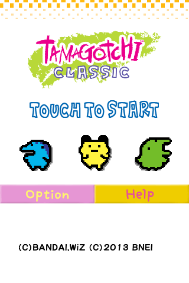
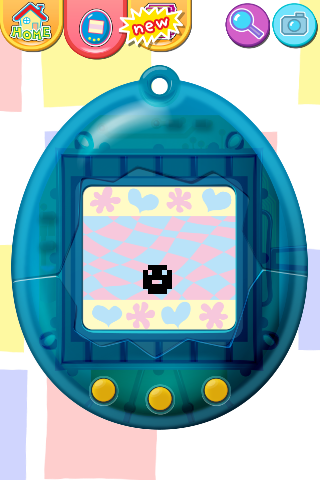
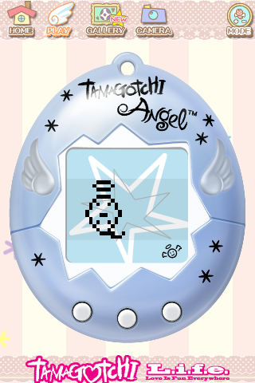
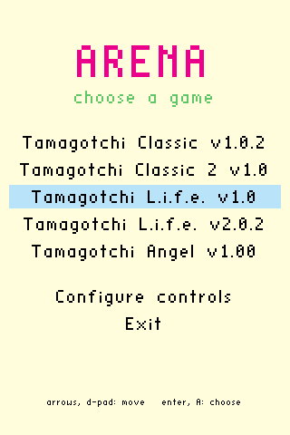
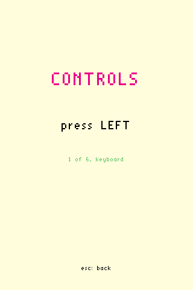

# Arena: tamatama

English | [Español](README.es.md)

**Playable.** The game runs from start to finish with the mouse as a finger,
or with a keyboard or a controller (see [Running](#running)): that part is
done. The migration to native code is still at an early stage and will move
slowly, in my spare time, as a project to learn and experiment.

Tamagotchi Classic (Android) migrated little by little to native code with
Arena. Supported versions (`src/port/apk_table.h`): Tamagotchi Classic 1.0.2,
Tamagotchi Classic 2 (Gen-2) 1.0, Tamagotchi L.i.f.e. 1.0, 1.01, 1.02, 2.00,
2.0.1 and 2.0.2, and Tamagotchi Angel 1.00.

| Classic: title | Classic: game | Angel: title | Angel: game |
|---|---|---|---|
|  |  |  |  |

| The `--menu` menu | Configure controls |
|---|---|
|  |  |

Tamagotchi is a trademark of BANDAI. The game screenshots are shown only to
document how Arena works; all rights to their images belong to their owners:
(C)BANDAI, WiZ (C)2013 BNEI for Classic and (C)BANDAI, WiZ (C)NBGI for Angel.
This project does not include any game file.

**Arena** is the migration project: a loader that runs the original `.so` of an
Android game without Android (on ARM, under QEMU on a PC) and lets you replace
its functions, one by one, with native code. What is already migrated runs
natively and the rest stays in the `.so`, until nothing of it is left. It is all
of `src/` except `src/port/`, which is tamatama: the game's code.

## Memory map

What the game's ARM code sees. From `0x60000000` to `0x70000000` is the arena
(here, the memory region, not the project): 256 MiB shared by loader and
loader-arm, although loader sees it at another address (`to_local` converts
between the two).

| Address | Size | What is there |
|---|---|---|
| `0x60000000` | 8 MiB | stack of the ARM code when there is a loader; its first word holds how much of the arena is in use |
| `0x60800000` | as big as it is | the game's `.so` |
| after it | | the JNIEnv and JavaVM tables |
| after that, up to `0x70000000` | the rest | the game's heap (`malloc`, `new`) and the 1 MiB stack of each thread |
| `0x70000000` | 64 KiB | the hooks' code: 16 bytes per hook, up to 4096 |
| `0x70010000` | 128 KiB | the hooks' data |

The addresses are requested without `MAP_FIXED`: if one is taken, the one the
system gives is used and the log says so. Without a loader (everything on the
CPU, as on the Pi), the heap and the thread stacks come from libc, and the stack
area stays reserved but unused. With `NATIVE=1` there is no `.so`, and the arena
is plain loader memory that keeps the same addresses.

## How the processes talk

Only when the ARM code runs under QEMU (on a PC, or on a 64-bit Pi without
32-bit support) are there two processes: loader (your natives, the backend and
`app_main`) and loader-arm (the `.so`, bionic, the fake JVM, the hooks and the
threads). In every other case, and with `NATIVE=1`, everything runs in one
process and none of this exists.

Before starting QEMU, loader opens three channels and leaves them to loader-arm
on fixed file descriptors (`src/shared/bridge.h`):

| fd | Direction | What |
|---|---|---|
| 3 | loader → loader-arm | pipe of `TO_ARM_*` commands: call a method by name or by address, look up a symbol, allocate memory, the result of a native, exit |
| 4 | loader-arm → loader | pipe of answers (`TO_HOST_RETURN`) and of native calls (`TO_HOST_NATIVE_CALL`) |
| 5 | both | the arena: a memfd both map; the data (objects, vertices, the stack) is read there without copying |

Only 32-bit words travel through the pipes: `[operation, bytes]` and then the
data. The first message from loader-arm is `HELLO` (its bytes spell "OKOK") with
the address of the arena, the base of the `.so` and the JNIEnv.

When the game calls a function that has a native, its hook in loader-arm sends
`TO_HOST_NATIVE_CALL` with the index of the native, r0-r3 and the stack pointer.
loader runs it, reading from the arena the arguments that do not fit in
registers, and answers with `TO_ARM_NATIVE_DONE` and the result. If that native
calls the game again (`call_method`), loader sends `TO_ARM_CALL_NAME` while
loader-arm waits: the calls nest. Only one call is in progress at a time; that
is why the game's threads take turns.

## The game is not included

Copy the original `.apk` into `apk/`, next to the program. The first time, its
md5 is checked and it is extracted into `resources/`; after that it is no longer
needed. The supported versions are listed in
[`src/port/apk_table.h`](src/port/apk_table.h).

## Building

```
make
```

Dependencies on Fedora:

```
sudo dnf install make gcc gcc-c++ clang lld qemu-user curl xz binutils tar SDL2-devel SDL2_mixer-devel fdk-aac-free-devel mesa-libGL-devel
```

The first time, it downloads an ARM libc from Debian into `sysroot/`. Options:

| Option | Values | What for |
|---|---|---|
| `BACKEND` | `sdl` (default), `dummy` | window, input and GL |
| `PLATFORM` | `linux` (default), `portmaster`, `android` | `portmaster`: `tamatama.zip`, the PortMaster port (and `make PLATFORM=portmaster rpi`, the Raspberry Pi packages); `android`: `tamatama.apk` |
| `DEBUG_CONSOLE` | `1` (default), `0` | the debug console (`--debug`) |
| `NATIVE` | `0` (default), `1` | `1`: no `.so` and no QEMU, everything native |
| `GLES` | `0` (default), `1` | `1`: OpenGL ES 1.1 instead of OpenGL 2.1 (Android and PortMaster use it) |

## Running

**`make` (default, `NATIVE=0`)**

| Machine | What you run | What happens |
|---|---|---|
| x86_64 PC | `./loader` | loader starts `loader-arm` under QEMU; the natives run in loader |
| 64-bit Pi (aarch64) with 32-bit support | `./loader` | as on the PC, but `loader-arm` runs on the CPU, without QEMU |
| 64-bit Pi without 32-bit support | `./loader` | as on the PC: `loader-arm` under QEMU |
| 32-bit Pi (armv7) | `./loader-arm` | only `loader-arm` exists, and it does everything on the CPU |
| Handheld with 32-bit ARM (PortMaster) | "Tamatama" in the ports menu: `tamatama.armhf` | as on a 32-bit Pi: everything on the CPU |
| Handheld with only aarch64 (PortMaster) | "Tamatama" in the ports menu: `tamatama.aarch64` | as on the PC: `loader-arm` under `qemu-arm.aarch64` |
| 32-bit Android phone (armeabi-v7a) | the Tamatama app | `libtama.so` is loader-arm: everything in the app, on the CPU |
| 64-bit Android phone (arm64-v8a, x86_64) | the Tamatama app | `libtama.so` is loader; `loader-arm` on the CPU if it still runs 32-bit ARM, or under QEMU |

**`make NATIVE=1`**

| Machine | What you run | What happens |
|---|---|---|
| x86_64 PC and 64-bit Pi | `./loader` | everything native in loader; no `loader-arm` and no QEMU |
| 32-bit Pi | `./loader-arm` | everything native in loader-arm; the `.so` is not loaded |

The handhelds use `make PLATFORM=portmaster`: unzip `tamatama.zip` into
PortMaster's ports folder; `Tamatama.sh` chooses the program and starts it
with `--menu`. The phones use `make PLATFORM=android`:
`adb install -r tamatama.apk`, and the games are imported in the app.

In every case the game is found the same way (version, resources and rules): the
`.apk` is always needed for its resources. `./loader --help` shows every option.

`./loader --menu` (or `./loader-arm --menu`) first opens a menu to choose the
game among the supported versions it finds (the `.apk` files in `apk/` and
those already extracted), with the arrows and Enter, with the d-pad and A, or
with the mouse. Without `--menu`, or when a game is given, it starts directly,
as always.

**Transfer Save.** "Transfer Save", in the menu (on Android, in the start
screen), passes the save of a version to another device on the same network:
another PC, a handheld or a phone with Tamatama. On the one that receives,
open "Receive Save" and leave it waiting; on the one that sends, "Send Save"
asks for the version and then lists the devices that are waiting. Each one
shows as user@hostname (system), or the phone model on Android (such as
Pixel 10a (Android)), with a 4-character signature, the same on both
screens: check that they match before accepting. Saves only pass
between the same version, nothing is written without "Accept" and the save
that was there is kept as a backup, which "Restore Backup" brings back.
There is no port to open, even with a firewall: it only fails on networks
that keep devices apart, such as guest Wi-Fi (see
[src/transfer/README.md](src/transfer/README.md), in Spanish).
`./loader --transfer` opens only Transfer Save.

**Android.** `make PLATFORM=android` builds `tamatama.apk` (see
[android/README.md](android/README.md), in Spanish). Its start screen lists
the versions to play and imports them: a `.zip` with the game's `.apk` files,
in its root or in folders. You play with your finger, as in the original, or
with a controller. It needs Android 5.0 or later, and it also works on recent
phones that no longer run 32-bit code: there the game runs under QEMU, inside
the app.

The game uses these actions: the four directions, accept, the three
Tamagotchi buttons (1, 2, 3) and exit. On the keyboard they are the arrows,
Enter, Z, X, C and Escape. A controller SDL recognizes (also those in
PortMaster's `SDL_GAMECONTROLLERCONFIG`) gets them automatically: the d-pad,
Y, B and A for 1, 2 and 3 (the device's buttons, left to right; X is also 3),
A also to accept, Start to accept and Back (Select) to exit. In the menu any
face button chooses, so it works even when a handheld comes with its buttons
swapped. To fix them, or to change the keys, "Configure controls" in the menu
asks for them one by one: if the first one is a key it configures the
keyboard (`keyboard.map`; exit is always Escape), and if it is a button, the
controller (`controller.map`, in the `SDL_GAMECONTROLLERCONFIG` format, and
it wins over PortMaster's). Accept and 3 may be the same button. Both files
go next to the program.

In the game, 1, 2 and 3 press the A, B and C buttons of the device. The
directions move a pointer (a pink triangle) between the buttons on screen,
by rows: up and down change rows, left and right move within one, down to
the device's own buttons. Accept presses the chosen one. When accept is also
3 (A), with no pointer on the device screen it presses C. When a dialog
appears, the pointer moves to its buttons; when the screen changes, to its
first button.

- On paged screens (the tutorial and the original manual), left and right
  turn the page and the pointer stays on Back.
- On screens without the device, up or down also lead to the center of the
  screen when there are no buttons that way: that is how you start from the
  title ("TOUCH TO START"). With no pointer, accept taps the center.
- The game's camera icon saves the screen to `screenshots/`, next to the
  program, as a PNG named with the date and time. On Android it goes to the
  gallery, in `Pictures/Tamatama`.
- Exit must be pressed twice: the first press shows "press again to
  exit". With `--menu` it goes back to the menu; Exit in the menu closes the
  program.
- When the game vibrates, the controller vibrates, if it can; if not, on
  Android, the phone.

Each screen is recognized by the button CSV the game reads when it opens,
and how it is navigated is set by a hand-written table per CSV
(`src/port/controls_table.h`).

## Rules

`--rules FILE` (or `--rules=FILE`) loads a rules file, relative to the current
folder. Without it, if `rules/{md5}.txt` exists next to the program, the one for
that version is loaded.

## Debugging

`./loader --debug` opens the debug console; to connect:

```
python3 tools/console.py
```

Everything else (finding and watching variables, who writes them, pauses,
`--trace`, `--callers`) is in [doc/debug.md](doc/debug.md).

How our own screens are made (the menu, Transfer Save) is in
[doc/screen.md](doc/screen.md).

## How the game works

[doc/tutorial_p1_rev_2.md](doc/tutorial_p1_rev_2.md) explains the game logic
found in the `.so`: the characters and their cards, hunger and happiness,
sickness, discipline, sleep and evolution, with the pseudocode in
[doc/code](doc/code).
